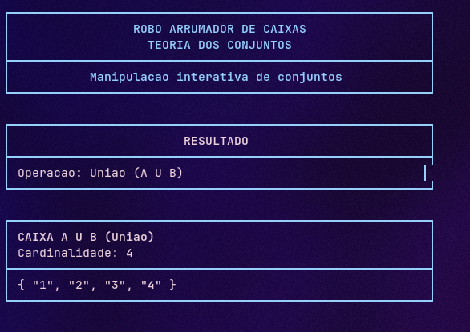
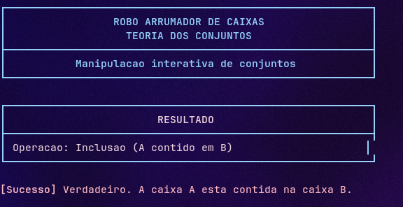
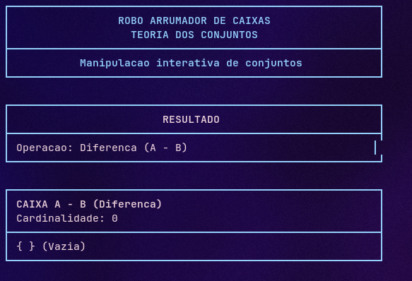
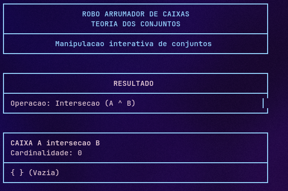
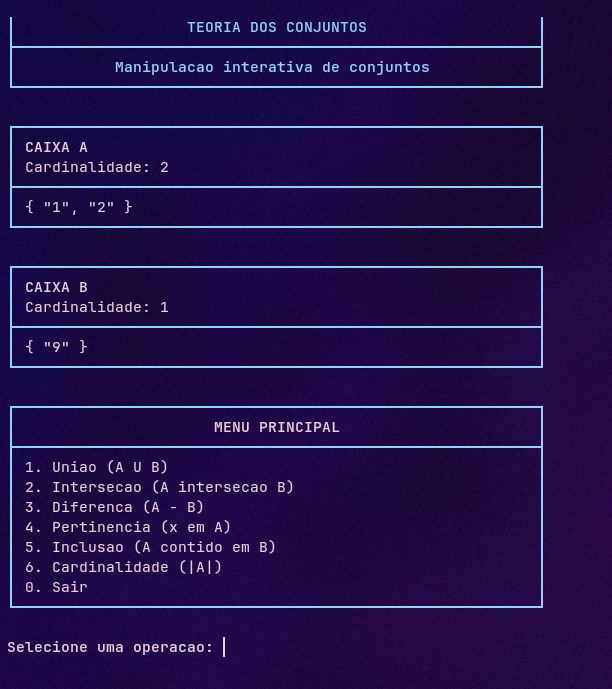
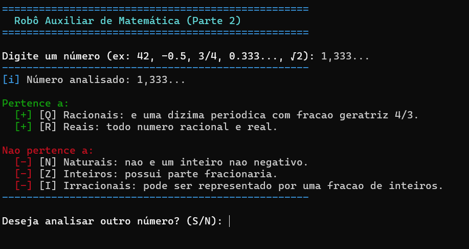
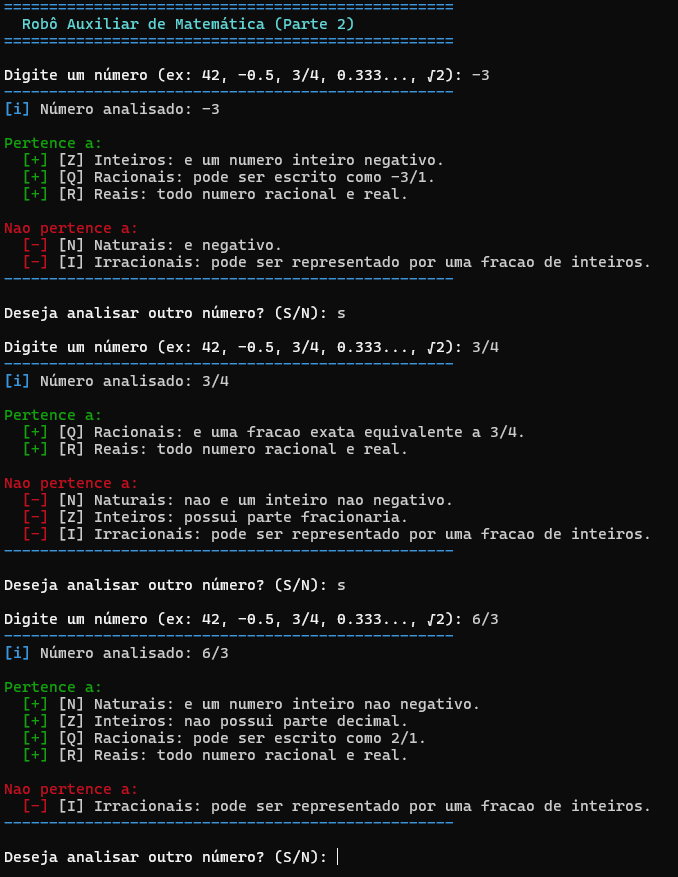
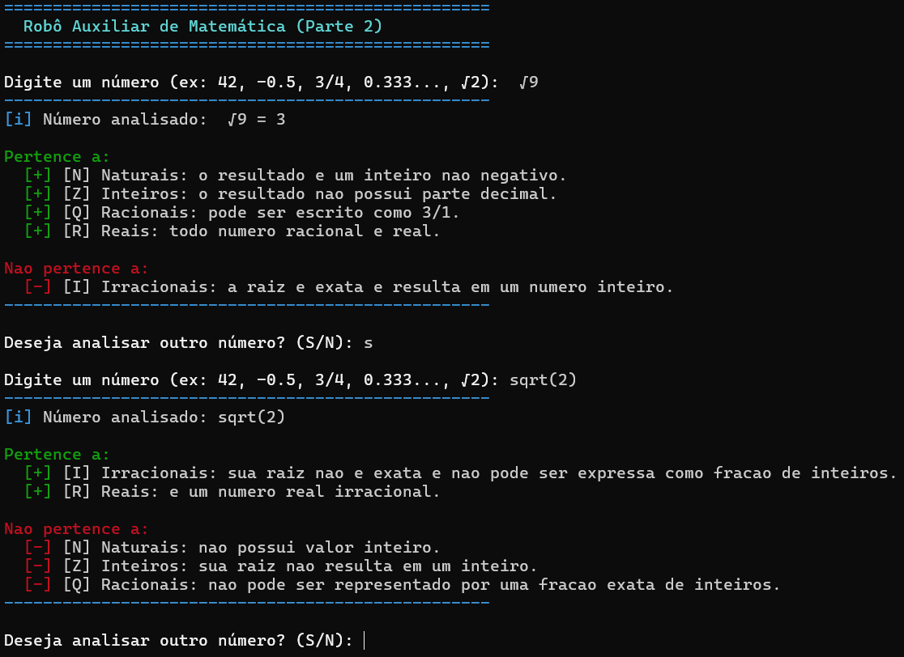
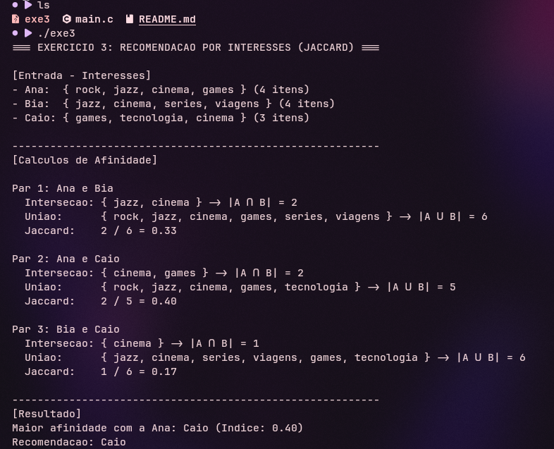

# Laboratório de Conjuntos e Conjuntos Numéricos
**Curso:** Desenvolvimento de Software Multiplataforma - FATEC Osasco  
**Disciplina:** Matemática para Computação  
**Integrantes:** Matheus Santos, Victor Hugo

---

## 🛠️ Tecnologias e Ambiente
- **Linguagem:** C (Padrão C11)
- **Compilação e Execução:** Docker e CMake

### Como Preparar e Executar os Exercícios:
```bash
# -- Preparando o Ambiente --
git clone [https://github.com/victtorH/Laboratorio_De_Conjuntos.git](https://github.com/victtorH/Laboratorio_De_Conjuntos.git)
cd Laboratorio_De_Conjuntos

docker compose build
```
# -- Executando os Exercicios --

* **Para rodar o Exercício 1:**
  ```bash
  docker compose run --rm compiler sh -c "mkdir -p build && cd build && cmake .. && make && ./exe1"
  ```

* **Para rodar o Exercício 2:**
  ```bash
  docker compose run --rm compiler sh -c "mkdir -p build && cd build && cmake .. && make && ./exe2"
  ```

* **Para rodar o Exercício 3:**
  ```bash
  docker compose run --rm compiler sh -c "mkdir -p build && cd build && cmake .. && make && ./exe3"
  ```


---

## 📌 Parte 1: Teoria dos Conjuntos (Básico)

*Responsável: Victor Hugo*

### Decisões de Implementação

*(Breve resumo técnico das funções criadas e modularização)*

### Prints de Execução e Casos de Borda

#### Caso Geral: Menu e Operações Principais



#### Caso de Teste 1: Conjunto Vazio (A = ∅, B = {1, 2})



#### Caso de Teste 2: Conjuntos Iguais (A = B = {1, 2, 3})




#### Caso de Teste 3: Conjuntos Disjuntos (A = {1, 2}, B = {3, 4})




#### Caso de Teste 4: Elementos Repetidos na Entrada (A = {1, 1, 1, 2})



---

## 📌 Parte 2: Conjuntos Numéricos (Intermediário)

*Responsável: Victor Hugo*

### Decisões de Implementação

*(Breve resumo da lógica de parsing, identificação de tipos e fração geratriz)*

### Prints de Execução

#### Teste 1: Dízima Periódica e Fração Geratriz (Entrada: 1,2(5))



#### Teste 2: Inteiros Negativos e Frações (-3, 3/4, -5/2, 6/3)




#### Teste 3: Raízes Exatas e Irracionais (√9 e √2)



---

## 📌 Parte 3: Sistema de Recomendação (Índice de Jaccard)

*Responsável: Matheus da Silva Santos*

### Decisões de Implementação

* **Modelagem Matemática:** Perfis de usuário representados como conjuntos finitos de texto. A regra formal de unicidade foi garantida verificando a pertinência antes de cada inserção.


* **Estrutura de Dados:** Utilização de vetores estáticos em memória local (`struct Conjunto`) para evitar vazamentos de memória e manter o algoritmo direto e seguro.
* **Métrica Aplicada:** Fórmula do Índice de Jaccard:

$$\text{Jaccard}(A, B) = \frac{\vert{}A \cap B\vert{}}{\vert{}A \cup B\vert{}}$$


### Demonstração de Execução



### Saída da Execução (Log Oficial)

```text
=== EXERCICIO 3: RECOMENDACAO POR INTERESSES (JACCARD) ===

[Entrada - Interesses]
- Ana   { rock, jazz, cinema, games } (4 itens)
- Bia   { jazz, cinema, series, viagens } (4 itens)
- Caio  { games, tecnologia, cinema } (3 itens)

----------------------------------------------------------
[Calculos de Afinidade]

Par 1: Ana e Bia
  Intersecao: { jazz, cinema } -> |A ∩ B| = 2
  Uniao:      { rock, jazz, cinema, games, series, viagens } -> |A ∪ B| = 6
  Jaccard:    2 / 6 = 0.33

Par 2: Ana e Caio
  Intersecao: { cinema, games } -> |A ∩ B| = 2
  Uniao:      { rock, jazz, cinema, games, tecnologia } -> |A ∪ B| = 5
  Jaccard:    2 / 5 = 0.40

Par 3: Bia e Caio
  Intersecao: { cinema } -> |A ∩ B| = 1
  Uniao:      { jazz, cinema, series, viagens, games, tecnologia } -> |A ∪ B| = 6
  Jaccard:    1 / 6 = 0.17

----------------------------------------------------------
[Resultado]
Maior afinidade com a Ana: Caio (Indice: 0.40)
Recomendacao: Caio

```
